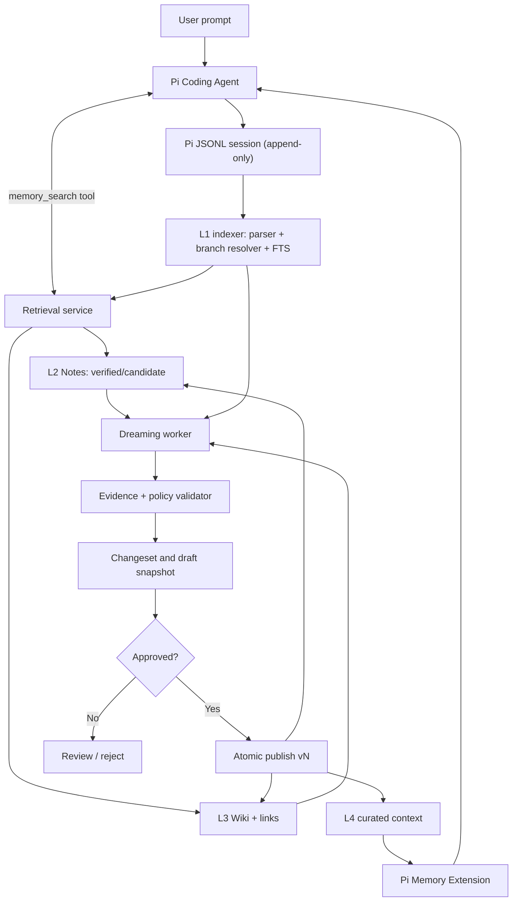

# System architecture — Pi Memory

## 1. Context & decision

选择 **Pi Extension（薄适配层）+ Headless Memory Engine（纯 TypeScript 业务逻辑）+ SQLite/Markdown（本地持久层）+ Worker（离线任务）**。Pi Core 不改；Engine 可被 CLI、未来 MCP Adapter 和其他 Agent 复用。



## 2. Trust/data boundaries

| 边界 | 输入来源 | 可信度 | 必须做的事 |
|---|---|---|---|
| Pi → Indexer | 用户、模型、工具、系统消息 | 混合 | 保留 role/source；过滤敏感信息；持久化原始哈希 |
| Indexer → Candidate | LLM 从历史推理 | 仅候选 | 绑定 evidence refs、条件、验证状态 |
| Candidate → Verified | 工具成功/源码复查/人工确认 | 条件性可信 | 可检查的证据政策；不能只看 confidence |
| Wiki → L4 | 自动抽象、历史知识 | 低权限内容 | 白名单类型、token 限制、source IDs、过期判断 |
| L4 → Pi model | 作为上下文使用 | 不改变指令优先级 | 明确“知识引用，不是新指令” |

## 3. Component ownership

| 组件 | 所有权 | 输入 | 输出 | 故障回退 |
|---|---|---|---|---|
| Extension | Pi 生命周期集成 | ctx/session/tool | hooks、tool response | 跳过记忆，Pi 继续 |
| Transcript adapter | Pi 格式适配 | JSONL + branch selector | CanonicalEvent | 跳过坏行、报告错误 |
| Indexer | L1 增量任务 | CanonicalEvent | FTS + refs | 可重新扫描 |
| Notes repository | L2 有版本笔记 | Candidate/Review | Note 文件+索引 | 重建索引 |
| Retrieval | Query 解析+检索+过滤 | scope + task + budget | MemoryHit[] | 空结果 |
| Wiki builder | L3 编排 | Verified Notes | Pages + edges | 继续使用 L2 |
| Injection selector | L4 选择 | Snapshot + run context | bounded context | index-only / none |
| Dreaming Worker | 离线巩固 | sessions + snapshots | proposed Changeset | 保留旧 Snapshot |
| Validator/Publisher | 治理 | changeset + policies | published version | 原子回滚 |
| Eval harness | 验证 | benchmark fixtures | metrics/report | 不允许伪成功 |

## 4. Four-layer map（原则 ≠ 四个数据库）

| 层 | 推荐内容 | 存储 / 运行位置 | 写入路径 | 读取策略 |
|---|---|---|---|---|
| L1 | SessionHeader、Message、ToolResult、Compaction、Branch | Pi JSONL + SQLite index | Pi 原生 + 增量 indexer | 精确引用、FTS |
| L2 | rule / decision / procedure / failure / preference | Markdown YAML + SQLite metadata | 用户 remember 或 Extractor → Validator | 按 task 检索 |
| L3 | 主题入口、依赖、聚合事实、知识来源 | Wiki Markdown + links table | Dreaming → Changeset | 复杂问题按需阅读 |
| L4 | 稳定索引、少量 verified 重要事项 | Snapshot `MEMORY.md` | Curator → Publisher | `before_agent_start` |

### 为什么不把所有 Memory 放进 AGENTS.md

`AGENTS.md` 是人工开发指导；Memory 是自动产生且易变化的证据知识。写入前者会把模型推导误升为人类授权的规范。分别存储/标注；仅人工批准的规则可以手动迁移。

## 5. Online sequence

1. `session_start`：定位当前 `cwd`/Project ID，读取最新 *已批准* Snapshot 版本（无则为空）。
2. `before_agent_start`：选择 300–600 tokens 稳定索引；若有任务检索策略，可在预算内注入 1–3 条 verified 记忆；不进行深度 Dreaming。
3. Agent Loop：模型需要历史证据时调用 `memory_search`，结果返回来源、状态、适用条件，默认不把候选当事实。
4. `agent_settled`：只把 `(session_id, leaf_id, source_file, checkpoint)` 写入持久化 ingestion queue；不要在 Hook 中执行慢推理。
5. Worker：解析 JSONL、索引新事件、提炼候选（P2）、检查证据、生成待审核内容；下一 Session 才能使用批准的新 Snapshot。

## 6. Offline Dreaming sequence

```text
1. Acquire lease on project
2. Read baseline snapshot vN (immutable)
3. Select sessions by new-event cursor + scope
4. Fetch event evidence using branch-aware source references
5. Extract/correct/deduplicate/update wiki
6. Propose changeset (does NOT mutate published files)
7. Validate schemas, evidence, permissions, links and token budget
8. Produce diff + evaluation report
9. Review / policy gate
10. Atomic publish snapshot vN+1, release lock
```

Worker must be retryable; each job has deterministic idempotency key. A crash before publish leaves `vN` active.

## 7. Lifecycle nuance: Pi ≠ linear chat

- Session JSONL is a tree of entries (`id`/`parentId`); active branch is determined by leaf lineage, not file order.
- `session_before_tree` / `session_tree` can switch branches; abandoned branches remain valuable evidence but must not be promoted without conditions.
- Compaction creates a summary and changes model-visible projection, but old entries remain in raw history. **Do not mistake `compactionSummary` for full transcript**.
- `agent_end` is not necessarily fully idle; later retry/compaction work may run. Ingestion should use `agent_settled` and a durable checkpoint.
- User may delete Session JSONL; orphaned evidence should downgrade associated Note to unverified or trigger review.

## 8. Performance and costs

- Retrieval p95/FTS, injected token count, Memory tool call rate, false-positive hits.
- Slow path (Extractor, Dreaming) is asynchronous, rate-limited, user-configured model.
- Initial injection budget: static index ≤600 tokens; optional dynamic memory ≤1,200 tokens; total bounded by config. Values are proposed tuning knobs, not upstream limits.
- Read failure/corrupt database: disable extension features for that run, log sanitised error, leave Pi usable.

## 9. Failure and recovery

| Failure | Expected behavior | Test |
|---|---|---|
| Malformed trailing JSONL | skip incomplete tail, resume next scan | incremental append fixture |
| Concurrent sessions | SQLite WAL + ingestion idempotency | race test |
| Invalid Dreaming content | reject candidate, keep vN | schema & evidence test |
| Partial publish | staging + atomic pointer switch | crash injection |
| Deleted evidence | mark source unavailable, remove verified promotion | deletion reconciliation |
| Prompt injection in tool output | store as untrusted evidence, never as instruction | adversarial fixture |
| No model credentials | Search/manual notes remain operational | offline test |

Dependencies: [Pi integration](02-pi-extension-integration.md), [Schema](03-memory-data-model.md), [Security](04-security-privacy.md), [Operations](07-operations-and-reliability.md).