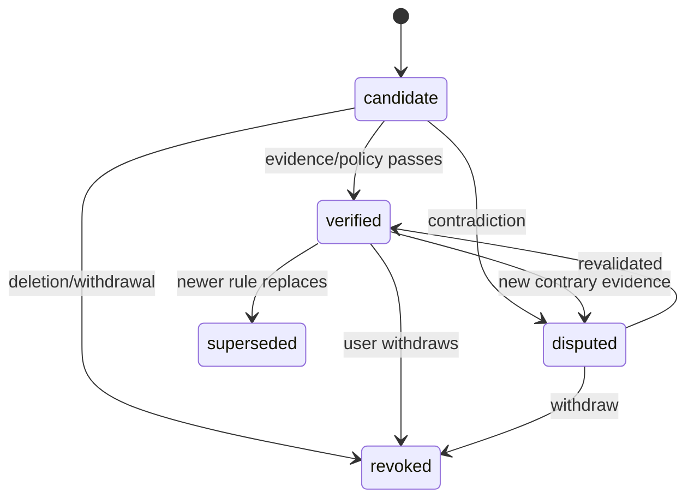

> **源码复核更正**：`source_file_hash` 随 Pi JSONL 追加/迁移变化，绝不能作为 source 主键。使用 `(source_namespace, session_id, entry_id)` 稳定身份与独立内容 hash。参考 [Runtime Matrix](12-runtime-lifecycle-matrix.md)。

# Memory data model, storage & schema evolution

## 1. Principle

原始记录不复制/不篡改，索引和聚合可重建，知识声明必须绑定来源。数据库是查询/一致性层，Markdown 是可读可审的内容层；所有引用稳定且可解析。真实实现以 `docs/schemas/*.json` 为机器可检验契约。

## 2. Canonical source event (internal)

```typescript
type SourceRef = {
  sessionId: string;
  entryId: string;
  branchLeafId?: string;
  sourceFile: string;       // mutable locator; verify path allowlist
  sourceHash?: string;      // evidence fragment hash only; NOT whole-file identity
};
type CanonicalEvent = {
  ref: SourceRef;
  parentEntryId: string | null;
  timestamp: string;
  role: "user" | "assistant" | "tool" | "system" | "custom";
  kind: "message" | "tool_call" | "tool_result" | "compaction" |
        "branch_summary" | "context_edit" | "metadata";
  toolCallId?: string;
  text?: string;            // redacted / bounded
  rawEntryHash: string;     // stable sha256
  visibility: "raw_only" | "model_context" | "both";
  resultStatus?: "success" | "error" | "unknown";
};
```

原始数据中的 assistant/tool 文本不是已核实事实。`resultStatus` 是工具执行结果状态，不是最终任务完成标志。

## 3. L2 MemoryNote

```text
id, schema_version, scope (global/project/task)
type (fact/procedure/decision/preference/failure)
title, content, applicability_conditions
status (candidate/verified/disputed/superseded/revoked)
evidence[] (source refs + evidence_kind + excerpt_hash)
created_at, updated_at, last_verified_at
links[] (wiki / note ids), supersedes?, owner?
source_trust (user_explicit/tool_verified/model_inference)
```

Status transitions:



“已验证”是 **特定证据和适用条件下** 的状态，不能因为 LLM confidence 高就升级。删除用户记录后需加入永久性 tombstone（按政策清理，不因旧 Snapshot 恢复）。

## 4. SQLite initial tables (conceptual DDL)

```sql
CREATE TABLE schema_migrations (
  version INTEGER PRIMARY KEY,
  applied_at TEXT NOT NULL
);
CREATE TABLE sessions (
  session_id TEXT PRIMARY KEY,
  cwd TEXT NOT NULL,
  source_file TEXT NOT NULL,
  source_mtime INTEGER,
  source_size INTEGER,
  parent_session TEXT,
  last_indexed_offset INTEGER NOT NULL DEFAULT 0
);
CREATE TABLE events (
  source_key TEXT PRIMARY KEY,  -- namespace/session/entry stable identity
  source_namespace TEXT NOT NULL,
  owner_id TEXT NOT NULL,
  project_id TEXT NOT NULL,
  session_id TEXT NOT NULL,
  entry_id TEXT NOT NULL,
  parent_id TEXT,
  type TEXT NOT NULL,
  role TEXT,
  timestamp TEXT NOT NULL,
  redacted_text TEXT,
  entry_hash TEXT NOT NULL
);
CREATE VIRTUAL TABLE events_fts USING fts5(
  redacted_text, content='events', content_rowid='rowid'
);
CREATE TABLE memory_notes (
  memory_id TEXT PRIMARY KEY,
  project_id TEXT NOT NULL,
  status TEXT NOT NULL,
  type TEXT NOT NULL,
  version INTEGER NOT NULL,
  markdown_path TEXT NOT NULL,
  updated_at TEXT NOT NULL
);
CREATE TABLE evidence_links (
  memory_id TEXT NOT NULL,
  source_key TEXT NOT NULL,
  relation TEXT NOT NULL,
  PRIMARY KEY (memory_id, source_key, relation)
);
CREATE TABLE ingestion_jobs (
  job_id TEXT PRIMARY KEY,
  idempotency_key TEXT NOT NULL UNIQUE,
  state TEXT NOT NULL,
  attempts INTEGER NOT NULL DEFAULT 0,
  payload_json TEXT NOT NULL
);
```

注意：此 DDL 为初版设计，实际查询必须在 SQL 中验证 owner/project/branch scope，不能只在返回结果后过滤。FTS5 external-content 需要为 insert/update/delete 编写触发器，并处理 rebuild；实现时还需加入 project/scope 权限列、关联索引、migration 和 WAL 参数。`events_fts` 不应对含密钥的原始字段建索引。

## 5. Namespace & project identity

- project_id 首选规范化 Git root + explicit installation namespace 的稳定标识；Git remote 只作辅助别名，不可直接作为租户认证。
- scope=global 只在当前用户安装内可见，默认不自动分享。
- scope=task 与活动 `session_id + branch_leaf_id` 绑定。
- 多工作树和不同分支需在 Note 的 `applicability_conditions` 明确版本约束。
- project_id 和 owner_id 必须作为检索的 *过滤条件*，不能只在结果展示端过滤。

## 6. L3 and L4 contracts

- WikiPage: `page_id, topic, links[], evidence_memory_ids[], status, content_hash, version`；不允许悬空 Evidence。
- L4: `snapshot_id, project_id, budget_tokens, selected_note_ids[], generated_at, memory_text`。只可从已发布且符合权限/状态的资料生成。
- Retrieval Hit: `id, source_layer, status, scope, title, snippet, score, evidence[], applicability, snapshot_id`；模型需要看到状态/出处。
- DreamChangeset: `base_snapshot_id, changes[], evidence_checked, validator_report, reviewer`；操作类型 create/update/merge/supersede/revoke/promote/wiki_update。

## 7. Schema/format versions

- 每条 JSON/Note 明确 `schema_version`；支持 migration from v1→v2，测试旧样本。
- Markdown YAML Frontmatter 只由 safe parser 读取，不可执行自定义 tags。
- Hash 算法初期 sha256，确保文档跨平台稳定；规范化换行/编码。
- 修改 Note 不直接覆盖已发布 Snapshot；先提 Changeset，再审计后发布。
- 迁移失败必须保持旧数据完整；备份数据库并保留 migration 日志。

## 8. Deletion and correction

- 原始 Pi Session 由用户/Pi 自己管理；Memory 不能隐式修改它。
- 删除某条 L2 Note → 撤回 FTS、Wiki backlinks、L4 injections、Snapshot 可见项，并写 tombstone。
- 用户明确要求清除原始 Pi 轨迹时，仅给出路径和安全操作说明；未经权限/确认不得删除。
- 证据文件被删除 → 索引 orphaned，自动降级/复核已发布 Note；不可悄悄继续标 verified。
- 撤回优先于回滚：任何回滚版本都必须应用 tombstone 过滤。

Refer to [schemas](schemas/memory-note.schema.json), [security](04-security-privacy.md), [P2](phases/P2-capture-dreaming.md).