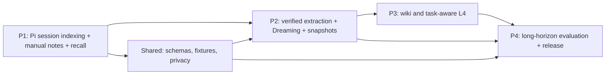

# Implementation roadmap — P1 through P4

> 所有阶段是规划，不代表代码已经完成。建议按 *验收门槛* 而非日历时间推进；禁止“写完文件即算完成”。

## 1. Dependency graph

## 2. Phase deliverables and gates

| Phase | 交付价值 | 核心任务 ID | 最小演示 | 退出条件 |
|---|---|---|---|---|
| P1 | 新 Session 能查旧事实 | P1-01..P1-10 | 修复一个 Bug、new session 检索 Evidence | Session 分支/压缩正确、FTS、手工 Note、L4、集成测试 |
| P2 | 能从经验中提炼并纠错 | P2-01..P2-10 | 旧错误 Note 被新证据纠正，diff 后发布 | 一次 Dreaming 可回滚、有证据审核、有幂等作业 |
| P3 | 多事件变为知识导航 | P3-01..P3-09 | 多次故障聚合成 Wiki，按需检索+注入 | Wiki 链接完整、污染可阻断、过期上下文可下线 |
| P4 | 证明有效且可安装 | P4-01..P4-10 | A/B/C/D/E 消融报告、安装/卸载 | 端到端稳定、安全、性能、发布检查通过 |

## 3. Start and stop rules

**P1 Entry**：空仓库文档基线完成、确定 Pi pinned version、Node 运行环境和最低 schema。

**P1 Exit (G1)**：
- 能导入 Pi v3 JSONL golden fixtures，包括 tool calls、compaction、fork/tree/context_edit；
- 对 `session_id+entry_id` 的来源可定位，增量索引幂等；
- `memory_search` 经 scope 过滤；手工 candidate Note 可保存/检索；L4 限预算；
- Extension 无权/无数据库/无认证时不阻断 Pi；
- unit + Pi headless integration 在 CI 通过。

**P2 Entry**：G1 全部通过，来源引用、Note Schema 冻结 v1。
**P2 Exit (G2)**：完成候选抽取、证据验证/冲突状态机、dry-run changeset、Snapshot CAS 发布/回滚；至少一个可复现的错误记忆纠正 demo；安全负例通过。

**P3 Entry**：G2 发布契约可用。
**P3 Exit (G3)**：Wiki 构建不破坏 provenance；支持 backlinks、broken-link check、selective Wiki+Search；L4 只从 approved/verified 集合生成；wiki changes 有版本 diff。

**P4 Entry**：G1–G3 的所有行为可由脚本复现。
**P4 Exit (G4)**：完成消融实验与成本报告，包含失败案例；安装/卸载/迁移/隐私控制文档与测试；打 tag 发布 beta。

## 4. Workstream boundaries

| Workstream | Owner area | Upstream dependency |
|---|---|---|
| Adapter | `src/transcripts` | Pi version |
| Data | `src/store`, `src/notes` | Schemas |
| Extension | `src/extension` | Engine API |
| Dreaming | `src/dreaming` | Notes + Evidence |
| Knowledge | `src/wiki`, `src/retrieval` | P2 snapshots |
| QA | `tests`, `evals` | deterministic fixtures |

可多路并行：P1 的 Adapter、DB migrations、Extension Tool mock；P2 的 Prompt 研究与验证器在 G1 之前能单独实验，但不能在接口未锁定时直接合并核心。P4 的 Eval fixture 设计应从 P1 开始。

## 5. Recommended PR slicing

- PR 1: repo baseline, CI, TypeScript, test fixtures.
- PR 2: JSONL parser + branch-aware SourceRef.
- PR 3: SQLite FTS index + idempotent ingestion.
- PR 4: search engine + Pi Extension tool.
- PR 5: manual Note + L4 + end-to-end demo (**G1**).
- PR 6: candidate extraction + evidence verifier.
- PR 7: conflict + Changeset + dry-run.
- PR 8: snapshots + background jobs + correction demo (**G2**).
- PR 9: Wiki builder + backlinks + consistency.
- PR 10: context ranking + promotion + Wiki/FTS routing (**G3**).
- PR 11: eval harness and all ablations.
- PR 12: privacy/reliability hardening + release (**G4**).

PR 拆分只是建议，不是强制数量；每个 PR 包含可运行测试、README/接口变更记录和错误路径。

## 6. Scope control

- P1 不做“自动学习”：手工 Notes 与自动 L1 索引足以建立基线。
- P2 不做全量企业知识图谱：先解决证据与错误纠正。
- P3 不急于引入 VectorDB：必须先拿到 FTS baseline。
- P4 不能只报告 recall@k：任务成功率和总成本必须同列。
- 若新能力使错误记忆扩散率恶化，则回退该能力，优先保留可验证主链路。

详细任务在 [tasks/](tasks/P1-backlog.md)；领域契约在 [Data model](03-memory-data-model.md)。