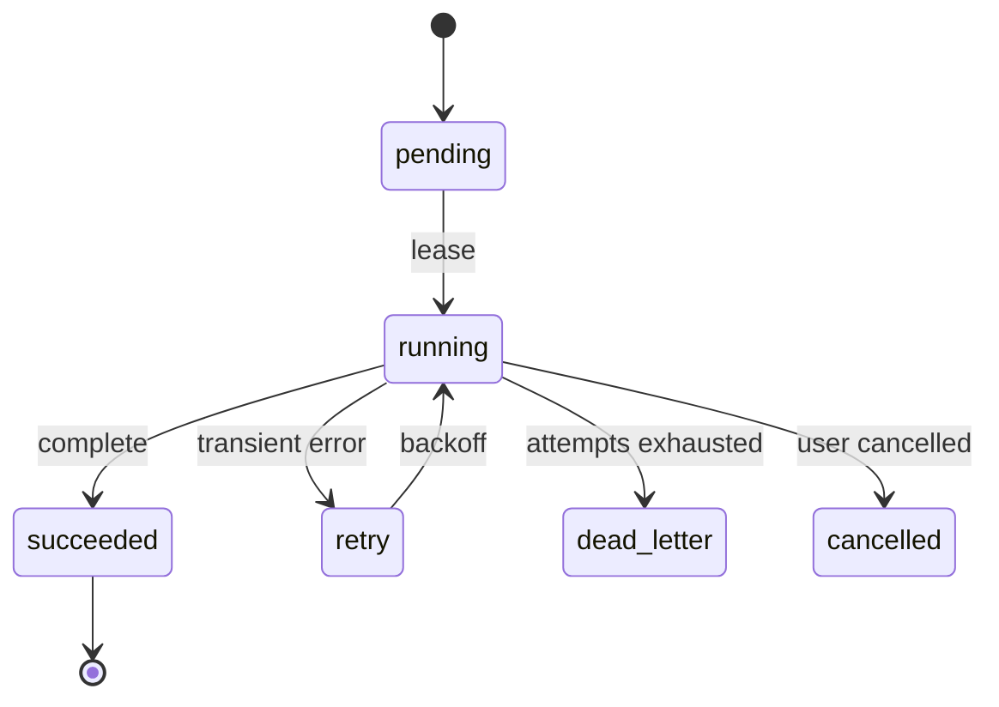

# Operations, observability and reliability

## 1. Runtime modes

- `Extension`：Git Source Package 安装后从源 TS 入口加载；低延迟、无必要长期守护进程，读取已批准 Snapshot，提供 Tools。
- `index`：纯本地可重建任务，支持按文件 offset 增量扫描和全量 rebuild。
- `worker`：离线候选提炼与 Dreaming，可显式 CLI 或外部调度运行。
- `review/publish`：用户审查 Changeset 并原子提交新 Snapshot；不在 hot path。
- `eval`：隔离 fixture 的 bench runner，不能使用用户真实私有项目数据。

## 2. Job state machine



Jobs 的 `idempotency_key` 建议包含 `project_id/session_id/leaf_id/indexed_cursor/source_hash/job_type`。相同幂等 key 仅有一条有效任务；重试不追加重复 Note。使用 SQLite 事务与超时租约恢复崩溃任务。

## 3. Ingestion algorithm

1. 扫描 SessionHeader 和有效 JSONL 行，记录完整行终止 offset；尾部不完整行暂不消费。
2. 读取 active branch 信息；使用 `entry_id` 唯一键和 hash 进行 UPSERT。
3. 对包含 Tool Calls 的 assistant message 提取工具名、参数摘要，与 toolResult 的 `toolCallId` 对齐。
4. 对错误/取消事件保存状态但不假定完成任务。
5. 将扫描 offset/size/mtime/hash 与索引写入同一个 SQLite transaction。
6. 文件缩短、同路径 session id 改变、hash 失配时触发全文件 reconcile。
7. 针对工具输出文本先 redact 再建 FTS，原始 Pi JSONL 不修改。

## 4. Publication consistency

推荐按以下顺序：
- Draft 存在独立 staging 目录，不影响 current pointer。
- 检查 schema/evidence/ACL/link/token budget；记录 validation report。
- 在单个 SQLite transaction 内确认 `base_snapshot_id == current_snapshot_id`；否则 retry/rebase Changeset。
- 使用原子 rename（同文件系统）发布版本目录和/或 pointer；SQLite 内记录已提交 snapshot，并有可恢复 journal。
- 若文件/DB 双介质提交中断，启动时按 journal reconcile（不可声称跨两介质天然原子）。
- 用户 forget tombstone 在查询时永远生效，回滚不能重现被撤回的 Note。

## 5. Observability

所有重要步骤附 `trace_id/project_id/session_id/branch_leaf_id/job_id/snapshot_id`，但日志不应含全文工具输出、密钥、用户私人路径。

指标：
- `memory_search_latency_ms` p50/p95；
- `index_backlog_size`、`ingestion_lag_seconds`、`job_retries_total`；
- `notes_candidate_total`、`notes_verified_total`、`notes_disputed_total`；
- `evidence_missing_total`、`wiki_broken_links_total`；
- `injection_tokens`、`injection_skipped_budget_total`；
- `dream_tokens_input/output`、`cost_usd`、`snapshot_rollback_total`。

## 6. Failure response matrix

| Symptom | Immediate action | Recover |
|---|---|---|
| SQLite locked | bounded retry; Pi recall fail open | WAL, busy timeout, one writer |
| DB corrupted | disable extension features for run | backup restore + rebuild from JSONL/Notes |
| Source file missing | mark orphaned | rescan, downgrade evidence-dependent notes |
| Dreaming hallucination | reject Changeset | inspect evidence, fix prompt/policy |
| Invalid schema | quarantine candidate | migration/repair tool |
| Stale pointer | read last valid snapshot | journal reconciliation |
| Slow model | cancel/timeout worker | exponential backoff |
| Security violation | stop promotion, log incident metadata | revoke note + rebuild L4 |

## 7. Configuration knobs

```yaml
enabled: true
capture:
  enabled: true
  projects_opt_in: true
search:
  max_hits: 5
  max_snippet_chars: 500
injection:
  enabled: true
  max_tokens: 1200
dreaming:
  enabled: false     # opt-in until reviewed
  max_sessions: 50
  max_retries: 3
privacy:
  redact_secrets: true
  allow_remote_model: false
```

初始默认是建议配置；P4 验证后应形成 schema + migration。远端 Dreaming 默认禁用，需用户同意。

## 8. Backup/restore drill

- 备份前 pause worker，记录 schema version、snapshot pointer。
- 重建索引优先从 Pi JSONL 和已发布 Notes；Snapshot 需要保留完整 manifests。
- 恢复后验证 evidence refs、tombstones、ACL、FTS 计数一致。
- 每个 P2/P4 release 必须演练“处理中断”和“上一版本 rollback”。

See [Security](04-security-privacy.md), [Snapshot ADR](adr/0003-snapshots.md).

## Audit addendum

- Detached Worker 无法继续访问旧 Pi Extension `ctx.modelRegistry`；应支持明确的 standalone authorized ModelAdapter 或在 Pi 活动命令中执行，远端传输需 opt-in。
- `getSessionFile()` 可能不存在；禁用/未授权项目不进行自动捕获。
- Git updater 会清理 package checkout，SQLite/Notes/Jobs/Snapshots 必须在外部 user data root。
- File rename + SQLite transaction 不是同一个原子提交，需 publish journal/reconciler。
- 恢复机制必须尊重遗忘 tombstone，防止重建索引时把原始 session 中被遗忘信息再次召回。